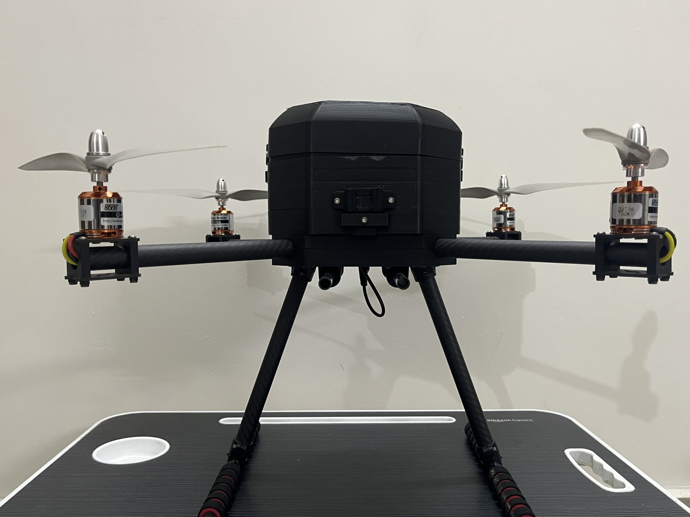
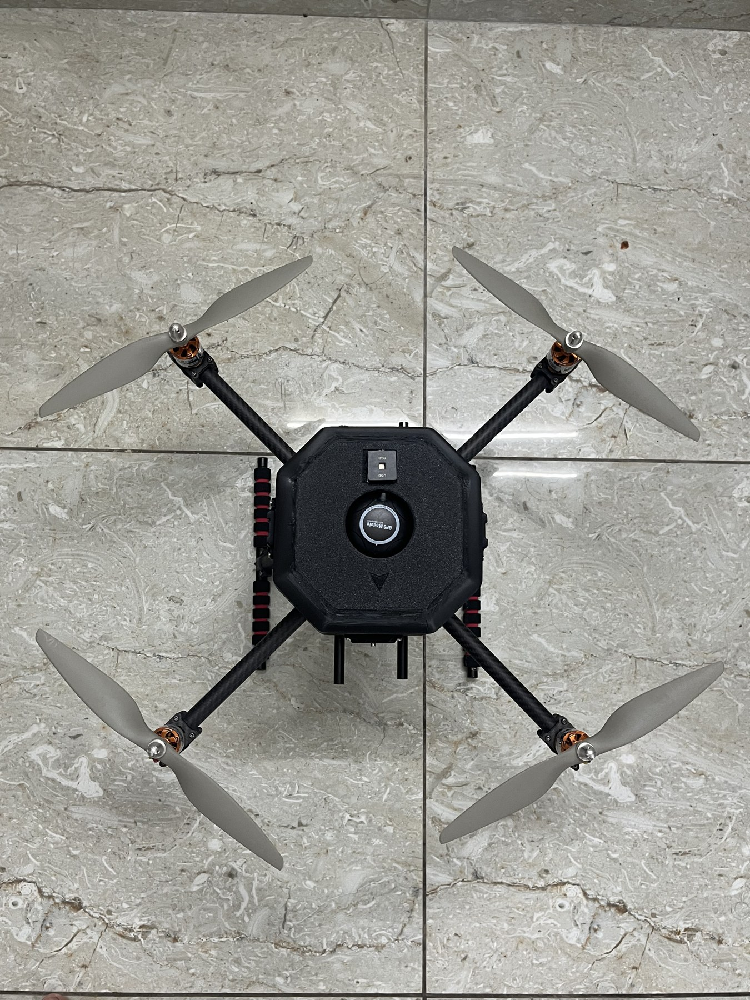

# Autonomous Waypoint Navigation Drone

**A Pixhawk 2.4.8 / PX4 quadcopter with successful autonomous waypoint missions and 25+ waypoints tested in a single mission.**

## Overview

This project explores GPS-guided autonomous flight through the integration of a carbon-fibre quadcopter airframe, electric propulsion, a Pixhawk flight controller, and an M10N GPS module. I handled assembly, wiring, flight-controller configuration, mission planning, and flight testing. A teammate created the enclosure CAD design, and we 3D printed the enclosure as a team.

The drone successfully completed preplanned waypoint missions, with 25+ waypoints tested in a single mission. This repository documents the hardware, my engineering contribution, and the available project media.

**Thiruppathi P**  
**Status:** Built and flight-tested with autonomous waypoint navigation.

## Hardware

| Component | Specification |
|---|---|
| Airframe | Carbon fibre, 500 mm wheelbase |
| Flight controller | Pixhawk 2.4.8 |
| Motors | DYS 750 KV |
| Electronic speed controllers | 45 A |
| Propellers | 1145 (11-inch diameter, 4.5-inch pitch) |
| Battery | 6200 mAh, 4S |
| GPS module | M10N |
| Flight firmware | PX4 |
| Ground-control tools used | QGroundControl and Mission Planner |

## Working principle

The ground-control workflow defines a route as geographic waypoints. PX4 on the Pixhawk uses navigation and attitude estimates to guide the aircraft along the mission, while adjusting the four motor outputs through the ESCs to control attitude and thrust. The M10N GPS provides positioning input. The battery supplies the propulsion and onboard electronics through the aircraft's power system.

## My contribution

- Assembled the airframe and integrated the propulsion and navigation hardware.
- Completed electrical wiring and component integration.
- Configured the flight controller for the aircraft.
- Planned autonomous waypoint missions.
- Conducted flight testing and tested 25+ waypoints in a single mission.
- Participated in 3D printing the enclosure with the team.

### Team contribution

A teammate created the enclosure CAD design. The enclosure was 3D printed collaboratively by our team.

## Project gallery

*Top view of the assembled aircraft, showing its four motors, propellers, arms, and central enclosure.*

### Flight video

[Open or download the flight video](media/flight-demo.mp4).

## Results

- Built and flight-tested the quadcopter.
- Successfully completed autonomous waypoint missions, with 25+ waypoints tested in a single mission.
- Integrated a team-designed, 3D-printed enclosure into the build.

The photos document the assembled aircraft, and the flight video shows takeoff and outdoor flight.

This project focuses on hardware integration and flight-controller configuration using existing PX4 firmware.

## Repository contents

| Location | Contents |
|---|---|
| `media/` | Two JPEG build photos, a video preview, and the flight MP4 |
| `docs/project-record.md` | Project evidence and contribution credits |
| `docs/repository-details.md` | Suggested GitHub name, description, and topics |

## Viewing this project

Open this README on GitHub to view the photos and follow the video link. After downloading the repository, open the JPEG and MP4 files using an image viewer and video player. No software installation or build step is required.

